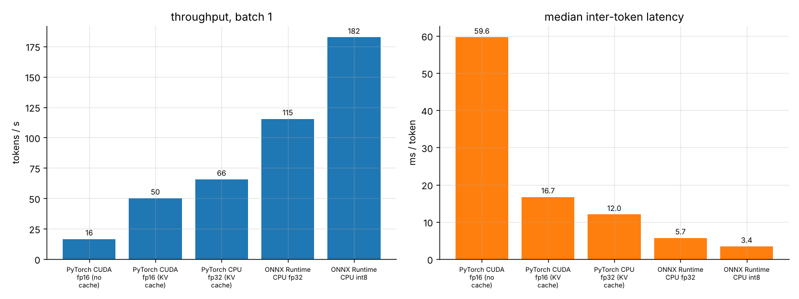
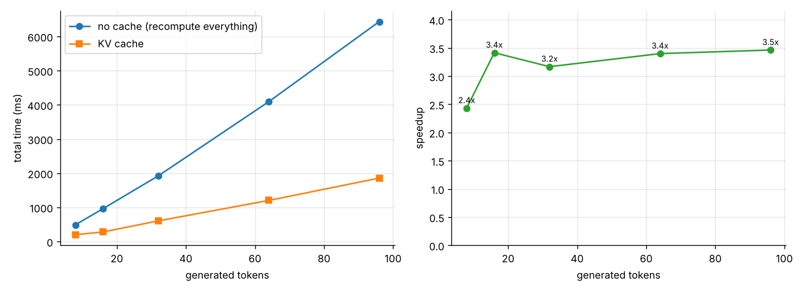
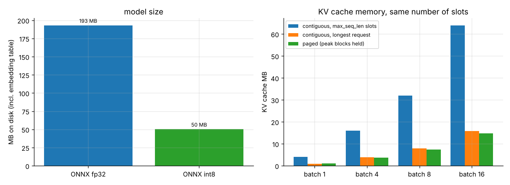
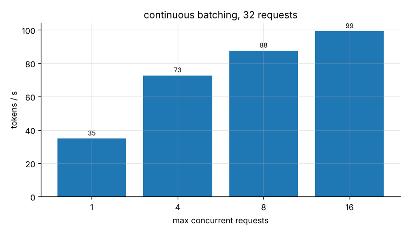

# multimodal-transformer-benchmark

[](https://github.com/AbhinandanMishra41/multimodal-transformer-benchmark/actions/workflows/tests.yml)

A small vision-language model written in plain PyTorch (no `transformers`), and a set of benchmarks for running it: KV cache vs. no cache, a paged KV cache with continuous batching, ONNX Runtime fp32 vs. int8, TensorRT for the vision encoder, and vLLM for the text decoder.

I built this to understand what actually happens between `model.forward` and a fast inference server. The main benchmark runs on a 4GB GTX 1650 under Windows; vLLM needs Linux, so that part runs in Docker or on Colab.

## What's in here

| Part | File | Notes |
|------|------|-------|
| ViT encoder | `src/vlm/vision.py` | conv patchify, CLS token, pre-norm blocks |
| Projector | `src/vlm/projector.py` | LayerNorm + 2-layer GELU MLP (LLaVA-1.5 style) |
| Decoder | `src/vlm/language.py`, `rope.py` | Llama-style: RMSNorm, RoPE, grouped-query attention (8 q heads / 2 kv heads), SwiGLU |
| KV caches | `src/vlm/kv_cache.py` | contiguous `KVCache`, block-based `PagedKVCache` |
| Continuous batching | `src/vlm/scheduler.py` | requests join and leave the batch as they finish, KV blocks get recycled |
| Toy training | `src/vlm/train.py` | coloured shapes + captions ("a red circle in the top left") |
| ONNX / int8 | `src/quantization/onnx_export.py` | vision graph + KV-cached decoder graph, ORT dynamic int8 |
| TensorRT | `src/quantization/tensorrt_engine.py` | engine builder + ORT TensorRT EP for the vision encoder |
| vLLM | `src/quantization/vllm_adapter.py`, `src/benchmark/vllm_run.py` | decoder exported as a `LlamaForCausalLM` checkpoint, checked against my implementation |

```
image [B,3,224,224] -> ViT (6 layers) -> 197 x 384 -> projector -> 197 x 512 --+
                                                                              |-> concat -> decoder (8 layers, GQA) -> logits
prompt ids [B,L] -----------------------------------> embeddings L x 512 -----+
```

The `compact` config is 42.0M parameters: 11.0M vision, 0.46M projector, 30.5M decoder.

## Walkthrough

[`notebooks/walkthrough.ipynb`](notebooks/walkthrough.ipynb) goes through everything with the `tiny` config (2.1M params) on CPU in a couple of minutes: the data, tensor shapes, training until it gets most captions right (~85% exact match on fresh images), KV cache vs. no cache, what the paged block tables look like, and the int8 export. Start there.

## Results

`compact` model (42M params) on a GTX 1650 4GB / Windows 11 / torch 2.6. Batch 1, 197 image tokens + 16 prompt tokens, 32 generated tokens, greedy decoding, 10 timed runs after warm-up. Full tables are in [results/BENCHMARK_RESULTS.md](results/BENCHMARK_RESULTS.md).

| backend | TTFT (ms) | per-token latency p50 (ms) | tok/s | size (MB) |
|---|---:|---:|---:|---:|
| PyTorch CUDA fp16, no KV cache | 80.9 | 59.6 | 16.5 | 80 |
| PyTorch CUDA fp16, KV cache | 81.0 | 16.7 | 50.1 | 80 |
| PyTorch CPU fp32, KV cache | 108.8 | 12.0 | 65.6 | 160 |
| ONNX Runtime CPU fp32 | 96.8 | 5.7 | 115.4 | 193 |
| ONNX Runtime CPU int8 | 62.6 | 3.4 | 182.4 | 50 |



What I took away from it:

- **The KV cache is worth 2.4x-3.5x end to end**, and 3.6x per token (59.6 -> 16.7 ms). A cached step is still O(T), since it attends over the whole history; what goes away is re-running every layer over every old token.
- **At batch 1, the GPU only wins the prefill.** It's faster on the 213-token prefill (81 vs. 109 ms), but each decode step is slower than on the CPU (16.7 vs. 12.0 ms). A decode step is one token through 8 layers of small matmuls, so on a 1650 it's dominated by kernel launches and Python overhead, not math. The attention is also hand-written (no SDPA / CUDA graphs) so it exports to ONNX cleanly, which doesn't help.
- **ONNX Runtime is 2.1x faster than eager PyTorch on the same CPU** with the same thread count (5.7 vs. 12.0 ms per token): fused ops and no Python per layer.
- **Dynamic int8 is 3.8x smaller (193 -> 50 MB) and 1.7x faster per token than ORT fp32**, with 100% top-1 agreement and identical perplexity on fresh toy samples. On a toy task that's an easy bar; I wouldn't read it as "int8 is free" for a real model.
- **Paged KV memory savings depend almost entirely on the baseline.** Against a contiguous cache that reserves `max_seq_len` (1024) per slot, paging uses ~76% less. Against one sized for the longest request in the workload it's within ±6%, and slightly *worse* at batch 1 because of block rounding. The real win is not having to know request lengths in advance.
- **Continuous batching scales throughput 2.8x from 1 to 16 concurrent requests** (35 -> 99 tok/s). But a paged decode step at batch 1 costs 25.6 ms vs. 16.7 ms for the contiguous cache: gathering blocks in Python is expensive, which is exactly what vLLM's paged-attention kernel avoids.





One honest caveat about training: 300 steps on the 1650 (about 30 minutes) gets the compact model to learn the caption *template*, but it only gets 5% of captions exactly right. In other words it hasn't learned to read the image yet. The tiny model in the walkthrough gets past that point and reaches ~85%. None of the latency numbers depend on this, but the int8 fidelity check is run on these weights.

## Setup

Python 3.10+, torch 2.5+. On Windows with an NVIDIA card:

```powershell
git clone https://github.com/AbhinandanMishra41/multimodal-transformer-benchmark.git
cd multimodal-transformer-benchmark
uv venv .venv --python 3.12
uv pip install --python .venv\Scripts\python.exe torch --index-url https://download.pytorch.org/whl/cu124
uv pip install --python .venv\Scripts\python.exe -r requirements.txt
```

On Linux/macOS: `pip install -r requirements.txt` (or `pip install -e ".[dev]"`).

## Running

```powershell
# tests (CPU, ~10 s)
.venv\Scripts\python.exe -m pytest -q

# full benchmark -> results/ and assets/  (the training step alone took ~30 min on a GTX 1650)
$env:PYTHONPATH = "src"
.venv\Scripts\python.exe -m benchmark.runner --profile compact

# re-plot from an existing report
.venv\Scripts\python.exe -m benchmark.visualize results/benchmark_report.json
```

On Linux/macOS use `PYTHONPATH=src python -m ...`. Exported models go to `artifacts/<profile>/` (git-ignored).

### TensorRT and vLLM

TensorRT has Windows wheels too: `pip install tensorrt` and swap `onnxruntime` for `onnxruntime-gpu` (they can't be installed side by side), and the runner will time the vision encoder under the TensorRT execution provider. vLLM is Linux-only:

```bash
docker build -f docker/Dockerfile.vllm_trt -t vlm-bench .
docker run --gpus all --rm -v $(pwd)/results:/workspace/results vlm-bench
```

or open [`notebooks/Colab_Full_Benchmark_vLLM_TRT.ipynb`](notebooks/Colab_Full_Benchmark_vLLM_TRT.ipynb) on a Colab T4.

## Limitations / TODO

- vLLM only gets the text decoder. Images can't go through it without a vLLM model plugin for the vision tower.
- TensorRT only covers the vision encoder. The KV decoder needs optimization profiles for a changing `past_seq_len`, and TRT int8 would need a calibrator or a QDQ model (the dynamic-int8 ONNX uses `MatMulInteger`, which TensorRT can't parse).
- The paged attention gathers each sequence's blocks in Python and pads them; vLLM does this inside a fused kernel. So the batching numbers are about scheduling and memory, not kernel speed.
- Attention is written out by hand (no `scaled_dot_product_attention`, no CUDA graphs) so the same code exports cleanly to ONNX. That leaves performance on the table on the GPU.
- No chunked prefill or preemption in the scheduler. If the block pool runs out, it raises.
- The embedding matrix is tied, so the ONNX export carries it twice: once for the host-side lookup and once as `lm_head` in the decoder graph.
- The training data is a toy. It's there to check that gradients reach the ViT and to give the int8 comparison trained weights, not to make a useful captioner.

## License

MIT
